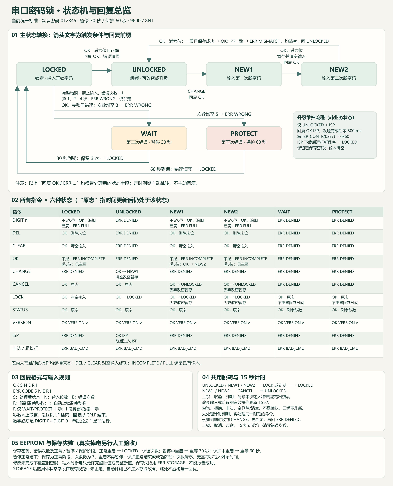

# STC89C52RC 电子密码锁与不断电升级

在指定开发板上，用同一份程序实现六位数字密码锁，支持矩阵键盘、八位动态数码管、蜂鸣器和串口。默认密码 **012345**，开机锁定。串口协议见下面，不得自行更改。

总评分为100分 , 占比如下 , 

人工检查不打分,只看是否完成任务了,某个功能性缺失,酌情减分

程序自动检查主要检查串口锁这个方面 , 进行自动化测试点打分

源代码是检查 代码包交由最强的AI工具进行分析,静态分析相关外设是否会导致堵塞,AI程度咋样

串口自动评分共 **100 分**，各项考点如下：

|编号|考点|分值|
|---|---|---|
|P01|基础输入与解锁|20|
|P02|组合操作一致性|15|
|P03|串口协议健壮性|10|
|P04|双次改密与校验|20|
|P05|超时自动上锁|10|
|P06|错误计数与保护|15|
|P07|不断电升级|10|


1. 支持数字输入、删除、清空、确认、上锁、取消修改和修改密码。键盘与串口操作同一份输入，可交替使用。输入不足六位不计错，超过六位不得覆盖；密码正确解锁，错误则清空输入并累计次数。

2. 仅解锁后允许改密，新密码连续输入两次一致才保存，保留前导零。取消、上锁或修改中断电不提交半个密码；提示保存成功后断电，新密码仍有效。

3. 解锁或修改过程中，15 秒无有效业务操作自动上锁。状态/版本查询、无效操作不得延时。按住按键只触发一次；提示期间仍正常响应。

4. 第三次错误暂停 30 秒，到期保留错误次数；第五次错误保护 **60 秒（统一验收值）**，到期清零；正确解锁也清零。限制期间只允许查询，上锁不得解除限制。**错误次数和限制阶段须断电保留**；限制中重启重新等待完整时长。

5. 数码管左起：第 1 位为状态码，第 2 位为错误次数，后六位实时显示当前输入，未输入处为 `-`。状态码 0/1/2/3/4/5/6 对应锁定/解锁/首次新密码/再次新密码/暂停/保护/升级准备。解锁显示 `----15` 形式的自动上锁倒计时；限制状态显示六位补零的剩余秒数。每次按键或完整串口命令均有声光反馈，100 ms 内开始，不能用长延时阻塞。

6. 仅普通解锁允许 `ISP`。回复后不断电软件复位进入芯片 ISP，电脑工具完成下载与校验，新程序锁定、保留已保存密码，并继续支持下一次升级。


|S1：1|S2：2|S3：3|S4：确认|
|---|---|---|---|
|S5：4|S6：5|S7：6|S8：删除|
|S9：7|S10：8|S11：9|S12：修改|
|S13：清空|S14：0|S15：取消|S16：上锁|


提交源码、**A 常暗/B 常亮两份 HEX（D8 状态不同，其余业务相同）**、电脑升级工具和编译说明。版本号可以相同。预先烧录 A，密码为 012345、锁定、无输入且错误次数为零。用学号和专属考试码登录评测 EXE，选择 COM 口与两份 HEX 后开始；期间不得操作开发板。服务器先评业务 90 分，再评 ISP 10 分；ISP 失败保留业务分。不限重考，取单轮最高分，成绩附核验链接。全流程成功后恢复默认密码、最终运行 B。物理按键、声光、真实断电和选手电脑工具另行验收。


# 串口接口

9600/8N1，无流控。ASCII，一行一条命令，LF 结束，接受 CRLF。无回显、无主动日志。正文最多 16 字节；非法、超长行丢弃至 LF 后返回 BAD\_CMD，不执行其中任何部分。必须整行收齐后执行，允许分多次到达。电脑收到完整回复后才发下一条。




# 示例输入输出

下面 **10 组相互独立**，默认保存的密码为 `012345`。发送以 `\n` 结束，**回复必须以 ****`\r\n`**** 结束**；这里用转义文字表示换行。

**1．输入一位数字**

内部状态：`LOCKED`，输入为空，错误次数 `0`。

```Plain Text
收到：DIGIT 0\n
返回：OK LOCKED 1 0 0 0\r\n
```

输入变为 `0`，仍锁定。

**2．不足六位就确认**

内部状态：`LOCKED`，已输入 `012`，错误次数 `0`。

```Plain Text
收到：OK\n
返回：ERR INCOMPLETE LOCKED 3 0 0 0\r\n
```

保留输入 `012`，不累计错误。

**3．六位已满，继续输入**

内部状态：`LOCKED`，已输入 `012345`，错误次数 `0`。

```Plain Text
收到：DIGIT 9\n
返回：ERR FULL LOCKED 6 0 0 0\r\n
```

输入仍为 `012345`，不得覆盖或追加。

**4．密码正确**

内部状态：`LOCKED`，已输入 `012345`，错误次数 `2`。

```Plain Text
收到：OK\n
返回：OK UNLOCKED 0 0 0 15\r\n
```

解锁、清空输入、错误次数清零，开始 15 秒自动上锁计时。

**5．第三次输错**

内部状态：`LOCKED`，已输入 `999999`，错误次数 `2`。

```Plain Text
收到：OK\n
返回：ERR WRONG WAIT 0 3 30 0\r\n
```

清空输入，错误次数变为 `3`，暂停输入 30 秒。

**6．第五次输错**

内部状态：`LOCKED`，已输入 `999999`，错误次数 `4`。

```Plain Text
收到：OK\n
返回：ERR WRONG PROTECT 0 5 60 0\r\n
```

清空输入，错误次数变为 `5`，进入 60 秒保护。

**7．暂停期间要求上锁**

内部状态：`WAIT`，输入为空，错误次数 `3`，剩余时间向上取整为 `23` 秒。

```Plain Text
收到：LOCK\n
返回：OK WAIT 0 3 23 0\r\n
```

命令返回成功，但**不解除暂停，也不重新计时**。

**8．第一次新密码输入完成**

内部状态：`NEW1`，已输入 `654321`，错误次数 `0`，尚未超时。

```Plain Text
收到：OK\n
返回：OK NEW2 0 0 0 15\r\n
```

暂存第一次新密码，清空输入，等待再次输入；此时还没有修改正式密码。

**9．两次新密码不一致**

内部状态：`NEW2`，第一次暂存 `654321`，本次输入 `654320`，错误次数 `0`，尚未超时。

```Plain Text
收到：OK\n
返回：ERR MISMATCH UNLOCKED 0 0 0 15\r\n
```

丢弃两次改密内容，回到解锁状态；正式密码仍为 `012345`。

**10．解锁后申请 ISP**

内部状态：`UNLOCKED`，输入为空，错误次数 `0`，尚未自动上锁。

```Plain Text
收到：ISP\n
返回：OK ISP\r\n
```

这是特殊回复，**不带状态字段**。串口发送完成后，非阻塞等待 500 ms，再软件复位进入 ISP。


文字版本的 10月24日12点开放 , 因为文字版本更容易复制给AI , 图像版本的更需要自己理解手敲

[串口接口规范](https://hdusmartcar.feishu.cn/wiki/Ya1CwLxXeiHrFMkjyhUciAT7n7g)

